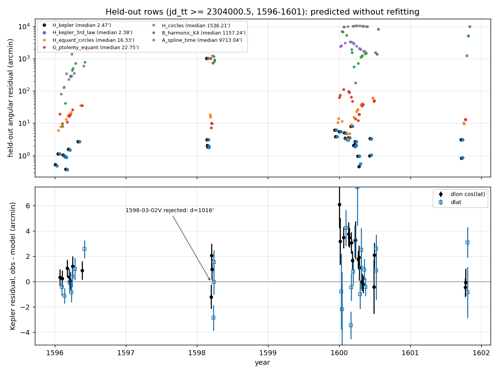

# What the observations say

> **Referee fixes applied after the freeze** (14 Oct 2026, see `REFEREE.md`): wording and disclosures only. `MODEL.json`, `fit.py` and every number are unchanged; the referee's re-run of `fit.py` reproduced `MODEL.json` byte for byte.

## Disclosure
The flags name the planet (Mars) and the sites (Hven, Wandsbek, Benatky, Prague), so I recognise this as the late
16th-century naked-eye Mars record, and I know the textbook answer. No orbital or planetary number entered any fit as a fixed value, bound or check. Three
*starting magnitudes* were typed: 0.02 and 0.08 for the two eccentricities and 0.03 rad for the inclination
(`fit.py:353`, `fit.py:410`; the docstring's "every start value comes from a frequency search" is therefore too strong).
Every other start comes from a frequency search on these rows, and least squares does the rest. The referee refitted
from e = 0, from e up to 0.3 at other apse directions and from random starts: all converge to the same solution, so
the typed starts do not reach the result. erfa was used only to rotate each row from "true ecliptic and equinox of date" into one fixed
frame (mean ecliptic and equinox of JD 2302000, mid-July 1590 by the file's own dates). All angles below are in that frame. Time origin is
T0 = JD 2302000.0 TT.

## Protocol in one paragraph
I wrote `PLAN.md` before any fit (amendments made before the first full run are marked there, and later additions sit
under "Post hoc"). `PLAN.md`, `fit.py` and `MODEL.json` entered the repository in one commit, and short trial fits
(`work/box.py`, `work/keptry.py`) ran before the first full run, so that the plan and its amendments came before them
rests on the plan's own statement, not on git history. I fitted on the 159 rows with jd_tt < 2304000.5 and predicted the 28 later rows (1596-1601) with no
refit. Of those 28, 15 come from one apparition (1600) and one is a 17-degree latitude slip that every model rejects,
so the held-out median mostly measures 1600. Residual d is the angular distance between the observed and predicted direction, in arcmin. Weights are
1/sqrt(sigma^2 + 0.5'^2). Outlier rule: a row is rejected if |z| > 5 x the robust (MAD) scale or d > 60'. The same frozen
scale is used to flag held-out rows. Decision rule: the lowest held-out median d wins; models within 1.25x of it are
tied, and the tie goes to the lowest training BIC.

## Scores of every model (arcmin)
| model | k | train rows rejected | in-sample median / RMS (all) | in-sample median / RMS (inliers) | held-out median / RMS (all 28) | held-out median / RMS (inliers, n) | BIC (Kepler-inlier set, post hoc) |
|---|---|---|---|---|---|---|---|
| A: smoothing spline in time (no physics) | 203 | 3 | 1.23 / 29.74 | 1.20 / 1.82 | 9713 / 8740 | - (0) | 1214.7 |
| B: two-frequency harmonic series K=1 (no physics) | 17 | 95 | 89.70 / 178.00 | 23.95 / 28.26 | 159.5 / 304.8 | 30.39 / 36.27 (7) | 3054.6 |
| B: K=2 | 41 | 63 | 13.45 / 1972.8 | 6.33 / 10.90 | 628.2 / 2668 | - (0) | 283.2 |
| B: K=3 | 77 | 6 | 1.03 / 4.69 | 1.03 / 1.71 | 21.33 / 6049 | 4.02 / 4.10 (4) | 479.1 |
| B: K=4 | 125 | 6 | 1.00 / 8.01 | 0.98 / 1.64 | 1157 / 2682 | - (0) | 622.0 |
| G: geocentric eccentric deferent + equant + epicycle | 10 | 60 | 7.18 / 26.42 | 3.90 / 6.59 | 22.75 / 198.1 | 10.00 / 10.97 (5) | 1733.3 |
| H: concentric circles round one centre (Copernican) | 7 | 131 | 546.4 / 1336.7 | 9.57 / 16.00 | 1536 / 1871 | - (0) | 3853.5 |
| H: eccentric circles + equants, both orbits | 13 | 14 | 4.92 / 9.42 | 4.61 / 5.75 | 16.33 / 193.6 | 9.02 / 9.54 (9) | 1097.8 |
| **H: Kepler ellipses, both orbits** | 11 | 6 | 1.38 / 5.07 | 1.36 / 2.01 | **2.46** / 192.1 | 2.21 / 3.23 (27) | 185.4 |
| **H: Kepler ellipses + a = P^(2/3) imposed** (family 7) | 10 | 6 | 1.37 / 5.06 | 1.33 / 2.00 | **2.38** / 192.1 | 2.08 / 3.19 (27) | **180.2** |
| H: Kepler + rotating apse lines (post hoc) | 13 | 6 | 1.30 / 5.05 | 1.24 / 1.94 | 2.98 / 192.2 | 2.55 / 3.14 (24) | 181.4 |

The held-out RMS over all 28 rows is about 192' for every physical model and should not be quoted. A single row causes it: 1598-03-02V has a
latitude of -14.3 deg, while its neighbours on 03-04, 03-06 and 03-07 sit at +2.54 deg. Every model misses that row by
1016'. The pre-registered BIC "common inlier set" turned out to hold only 10 rows, because the circle and K=1 models
reject almost everything. Its values are in `MODEL.json` but carry no information, so the post hoc BIC column refits
every model on the 153 Kepler-inlier training rows.

Notes on the comparison (referee, post freeze):
- The smoothing spline cannot extrapolate (its end segment is a cubic), so its 9713' is not a comparison; the
  flexible-model comparison is the K = 3 harmonic series, 21'.
- The harmonic series uses the index set |j| + |k| <= K, not PLAN's |j|, |k| <= K (an implementation change, not
  disclosed at the time); K = 1 therefore has 17 parameters.
- The geocentric model's uniform circular epicycle cannot carry the observer's eccentricity, so it is handicapped by
  construction; the equant conclusion rests on the heliocentric equant model.
- A wider equant multistart (48 starts) gives 4.79' / 15.4' instead of 4.92' / 16.3'; read the equant scores as
  "about 5' in sample, 15-16' held out".

**Decision.** Two Kepler models sit within 1.25x of the best held-out median: the free one (2.46') and the one with
the size-period law imposed (2.38'). BIC breaks the tie in favour of the law-imposed model (180.2 vs 185.4; on the
pre-registered tiny set, 25.5 vs 28.5). Among the families fixed in advance, the free Kepler model wins. The next
best family is 7x worse on held-out rows (equant circles, 16.3'). The flexible no-physics models fit the training rows
as well as Kepler does (1.0-1.2'), but the best of them misses the later years by 21'.

Figure: the top panel shows held-out angular residuals for each model, on a log scale. The bottom panel shows the
free Kepler model's held-out residuals by component (the winning law-imposed variant differs by under 0.2'), with
1-sigma bars including the floor.

## The winning model: two Keplerian orbits around one centre
Parameters (σ from the training Jacobian, scaled by reduced χ² = 1.54):

| | inner orbit ("E", carries the observer) | outer orbit ("P", the planet) |
|---|---|---|
| sidereal period | 365.2544 ± 0.0019 d | 686.9754 ± 0.0044 d |
| eccentricity | 0.01701 ± 0.00013 | 0.092992 ± 0.000075 |
| longitude of perihelion (1590 frame) | 95.6 ± 0.4 deg | 328.55 ± 0.05 deg |
| mean longitude at T0 | 301.822 ± 0.006 deg | 103.210 ± 0.003 deg |
| semi-major axis | 1 (unit) | 1.523692 (from the law; free fit: 1.523649 ± 0.000062) |
| plane | reference plane (ecliptic) | inclination 1.8562 ± 0.0012 deg, ascending node 46.35 ± 0.03 deg |

What it says about how the system works:
1. **Two motions, one centre.** The planet's apparent path, loops included, is the difference of two closed orbits
   that share one focus. One orbit has a period of 365.25 d and carries the observer. The other has a period of
   686.98 d and carries the planet. The loops repeat with the synodic period, 779.93 ± 0.004 d, which equals
   1/(1/P_E - 1/P_P). The planet's plane is tilted 1.86 deg to the observer's (that both planes pass through the common focus is assumed in the model; the fit does not contradict it).
2. **The orbits are ellipses traced with equal areas, not circles.** Concentric circles miss by degrees. Eccentric
   circles with equants get down to about 5' in-sample and about 10-16' held out. The best equant solution needs
   different equant fractions for the two orbits: 1.82 for the planet and an ill-defined one for the inner orbit.
   Kepler's ellipse with Kepler's equation reaches the observational noise (median 1.3', reduced χ² 1.5 with the
   0.5' floor) using fewer parameters. The geocentric deferent-plus-epicycle model lands on an equant fraction of
   1.951 ± 0.004, close to the classical bisection. That is the first-order-in-e imitation of an ellipse. It still
   fails at the 10' level. The heliocentric equant version, which also gives the inner orbit an eccentric centre,
   fails about as badly, so the limit is the equant itself (uniform angular motion about a point), not only the
   missing eccentricity of the observer's orbit.
3. **The regularity: size and period are locked.** With the size ratio left free, a_P/a_E = 1.523649 ± 0.000062. The
   periods give (P_P/P_E)^(2/3) = 1.523692. So a³/P² is the same for both orbits to 0.99991 ± 0.00012, and the
   exponent is q = 0.66662 ± 0.00006, consistent with 2/3 (-0.7σ). With two orbits, q is a measurement from two
   points, not a test of a power law: what the data show is that a³/P² is the same for both orbits. Imposing it raises χ² by only 0.8 for one fewer parameter, so
   BIC prefers it and the held-out median improves slightly. This is Kepler's third law, recovered blind from
   direction-only data.

## Limits of what these data can say
- **Only directions are observed.** The data fix the shapes, the size ratio and the timing of the *relative* motion.
  They cannot fix the absolute scale, and they cannot tell a Sun-centred system from an Earth-centred one with the
  same relative motion (Tycho's arrangement predicts identical directions). Which orbit carries the observer is also
  a reading choice. An observer on the 687-d orbit, rotated by 180 deg, looking at a body on a 0.656-size 365-d orbit,
  would see exactly the same directions. I put the observer on the 365-d orbit by convention. The third law holds in
  either reading.
- **The held-out longitude drift in 1600.** The 1600 Benatky series sits +2' (mean) east of the prediction in
  longitude, while 1596 and 1598 match to about 1'. Letting both apse lines rotate (post hoc) did not help: held-out
  error went from 2.46' to 2.98', and it needed a meaningless -37 ± 10 deg/century for the inner orbit. The
  offset is not a data systematic: a referee check made with the modern ephemeris the fit was forbidden to use (the
  reduction's own per-session check, `../out/BATCH.md`) puts these 15 rows +0.55' from DE441 in longitude, so the
  model sits about 1.7' west of DE441 there, at the 1600 opposition, four years beyond the training span. That this
  is the two-body model's limit is inferred, not tested (no two-body fit to the ephemeris was extrapolated): its size
  matches the expected next correction, the planets' pull (Jupiter moves Mars's mean longitude by up to 0.64' over
  the span, amplified about 2.7x at opposition), plus unmodelled light time and aberration (under 0.5'). The original wording here ("most likely a systematic of that observing series") was wrong.
- **Bad rows the model exposes.** The model rejects 6 training rows and 1 held-out row. Shifting the time by exactly
  one day brings three of them to within 2'. That makes them date-convention or day slips:

  | row | miss at the recorded date | miss after the shift |
  |---|---|---|
  | 1586-09-23V | 35.8' | 1.8' at -1 d (it is also out of order with 1586-09-24M) |
  | 1594-02-14V | 37.1' | 0.6' at +1 d |
  | 1583-01-25V | 9.0' | 1.1' at +1 d |

  1598-03-02V is a latitude slip of about 17 deg. 1585-01-17M, 1585-02-09V and 1593-11-27V are off by 7-24' for
  other reasons.

Files: `PLAN.md`, `fit.py` (+ `report.py`), `MODEL.json`, `heldout_residuals.png`, `work/` (logs, residual tables,
`slips.py`, `posthoc_apsides.py`), `FROZEN.txt`.
