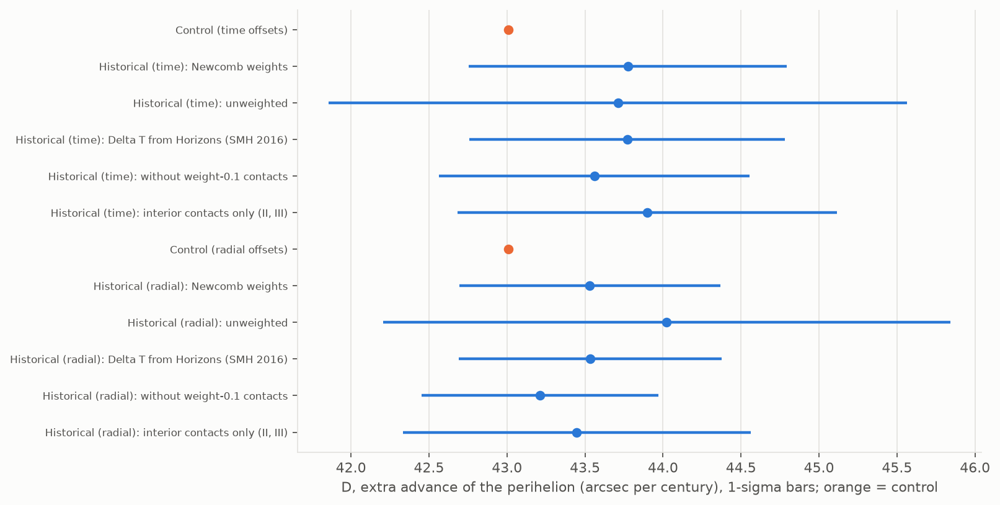
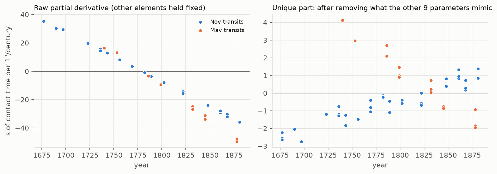
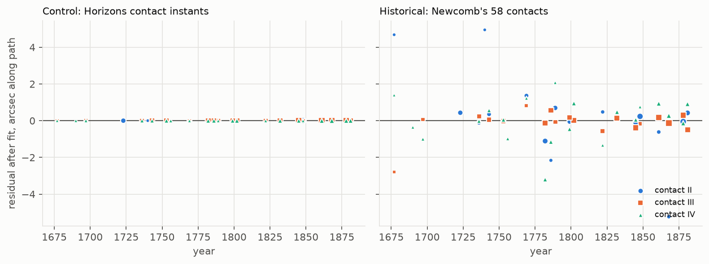
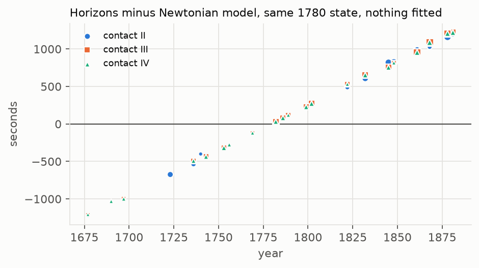
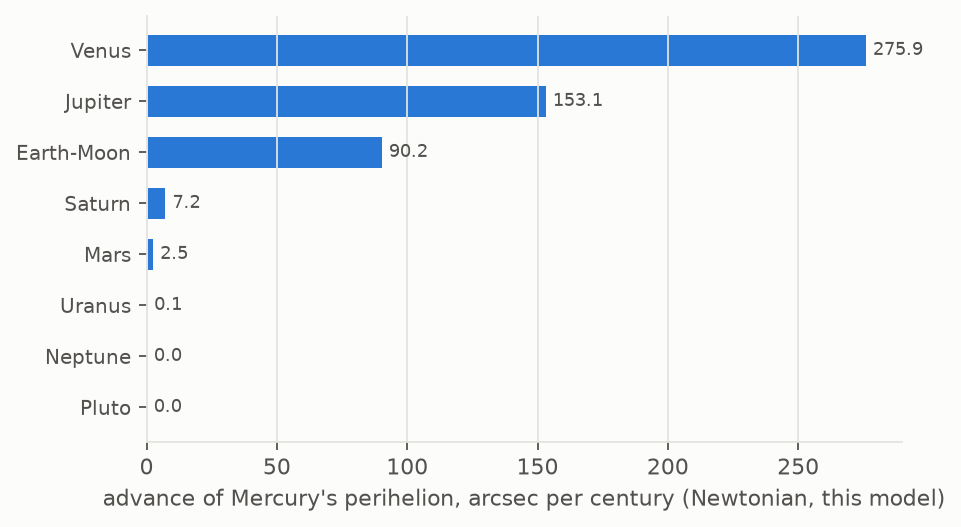

# Episode 3 measurement: the perihelion drift that the planets leave unexplained, from 1677-1881 transits

Run on 13 Oct 2026 from 21:09 to 22:15 CST, entirely on the owner's Mac (the box was not used). This
was a blind run: no expected value was looked up or quoted, and no theory is named. The control is called
"Horizons' physics".

## Result

**Fitted to Newcomb's 58 transit contacts (1677-1881), a Newtonian model of Mercury needs an extra
advance of the perihelion of D = 43.7 ± 1.0 arcseconds per century.** That is the pre-registered
headline variant. The variant with the physically better-conditioned constants (see Method) gives
**43.5 ± 0.8**.

**Control: the same pipeline on Horizons' own contact instants at the same 58 contacts gives
D = 43.008 ± 0.002.** This is what the pipeline extracts from perfect data generated with Horizons'
physics.

| | D, arcsec per century | 1 sigma: formal (scaled) / Monte Carlo / leave-one-transit-out jackknife | Weighted rms after fit |
|---|---|---|---|
| **Historical, headline** (time offsets per contact type, Newcomb weights, Delta T Espenak & Meeus) | **43.7** (numerical spread ±0.1 along a flat direction, see convergence note) | 1.02 / 1.01 / 0.82 | 8.2 s (1.4" rms along path) |
| Historical, radial offsets per contact type | 43.53 | 0.84 / 0.83 / 0.58 | 6.6 s (1.4") |
| **Control**, Horizons' contact instants, time offsets | **43.007** | 0.0015 (a numerical floor of a noise-free fit, not a measurement uncertainty) | 0.012 s |
| Control, radial offsets | 43.008 | 0.0015 | 0.012 s |
| Historical minus control | +0.7 ± 1.0 (headline); +0.5 ± 0.8 (radial) | | |

The historical value and the control agree within 1 sigma.

**How the uncertainties compare.** The Monte Carlo is not an independent check: it draws Gaussian noise
through the same linearised design matrix, so its agreement with the formal σ only confirms the covariance
arithmetic. The leave-one-transit-out jackknife is the independent estimate, and it is smaller than the
formal σ (0.58 against 0.84, and 0.82 against 1.02). Either Newcomb's weights are slightly pessimistic,
or the scatter is not Gaussian; the formal values are quoted as the conservative ones.

**Which constants to prefer.** The radial form fits better than the pre-registered time form with the
same number of parameters (weighted rms 6.6 s against 8.2 s), converges cleanly and gives interpretable
constants. I keep the pre-registered form as the headline rather than switch after seeing results; the
two differ by 0.2, a fifth of σ. Which to quote in the paper is for the referee.

In short: the 1677-1881 transit record, fitted with Newton plus the planets, contains an unexplained perihelion advance of 43.5-43.7"/century, known to
about ±1"/century. Perfect data with Horizons' physics yields 43.01 through the same pipeline.

### Robustness (linear re-solves around each solution, same Jacobian)

| Variant | Time offsets (pre-registered) | Radial offsets |
|---|---|---|
| Newcomb weights (headline) | 43.78 ± 1.02 (main run's linear-step point; wide re-fit 43.65-43.72) | 43.53 ± 0.84 |
| Unweighted | 43.71 ± 1.85 | 44.02 ± 1.82 |
| Delta T from Horizons (Stephenson, Morrison & Hohenkerk 2016) instead of Espenak & Meeus | 43.77 ± 1.01 | 43.53 ± 0.84 |
| Without the four weight-0.1 contacts (1677 II, III, IV and 1740 II) | 43.56 ± 1.00 | 43.21 ± 0.76 |
| Interior contacts only (II, III; 37 contacts) | 43.90 ± 1.22 | 43.45 ± 1.11 |
| Leave one transit out, range over 23 transits | 43.47 (without 1845) to 44.25 (without 1878) | 43.19 (without 1740) to 43.95 (without 1786) |

- **Delta T is not a limiting systematic here.** Switching models moves D by less than 0.01. A clock
  error shifts November and May contacts the same way in time, while D's unique signature has opposite
  slopes at the two nodes (figure below).
- **Removing the weight-0.1 contacts** (Halley 1677 and Winthrop 1740) lowers D by 0.2-0.3.
- **The leave-one-out extremes come from single transits:** see the table above.

## Method

**Data.** Newcomb's 58 concluded geocentric contacts (*Astron. Papers* vol. 1 part VI, pp. 451-452): 23
transits, made up of 37 interior contacts (18 at II, 19 at III) and 21 at IV, with his weights (0.1-6). Times
are GMT on the astronomical day (+12 h), converted to TT with Espenak & Meeus (2006) Delta T. Inputs are
in `out/measure_input.csv`. Newcomb's own *k* Delta-t terms were not used.

**Model (Newtonian only).** Built in REBOUND 4.4.10 with IAS15, from source because the 5.x wheel does
not load on this Intel Mac.

- **Bodies:** point masses for the Sun, Mercury, Venus, the Earth-Moon barycentre, and the Mars,
  Jupiter, Saturn, Uranus, Neptune and Pluto system barycentres.
- **Masses:** GM values from DE440/DE441 (Horizons headers and Park et al. 2021).
- **Initial conditions:** Horizons DE441 barycentric states at 1780-01-01 TDB, in the J2000 ecliptic
  frame.
- **Left out:** everything beyond Newtonian point-mass gravity, solar oblateness, asteroids, and the Moon
  as a separate body.

**Geometry.** Only Mercury's heliocentric motion comes from the model. The geocentre and the Sun's
barycentric position are Horizons' (bodies 399 and 10). The Earth's orbit is treated as known, as it was
from solar observations, and Mercury is the system under test.

- **Corrections:** light-time for the Sun and Mercury, and first-order annual aberration. No light
  deflection.
- **Contact condition:** the centre separation equals R☉ − r☿ for II and III, or R☉ + r☿ for IV, with
  Horizons' radii (695,700 km and 2,440.53 km).
- **Finder:** spline-interpolated on a 1-second grid.

**The parameter D.** An extra inverse-cube central acceleration on Mercury, a = −C r̂ / r³. By Newton's
theorem of revolving orbits, this rotates the orbit uniformly, which is a pure apsidal advance. C was
calibrated to arcsec per century three ways:

| Method | ″/cy per unit C (AU⁴/day²) |
|---|---|
| Two-body run at C = 4e-12 | 2.452482 × 10¹² |
| Two-body run at C = 8e-12 (linearity check) | 2.452482 × 10¹² |
| Analytic, π C / h² per orbit | 2.452480 × 10¹² |
| Full N-body difference run | 2.451992 × 10¹² |

D is the advance of Mercury's heliocentric longitude of perihelion in the inertial J2000 ecliptic frame,
positive prograde, beyond the Newtonian model.

**Fit.** Damped Gauss-Newton with numerical Jacobians (8 integrations per iteration, 6 processes). The 10
parameters are:

- Mercury's heliocentric osculating a, e, i, Ω, ϖ, l at the 1780 epoch
- D
- one constant per contact type (II, III, IV)

Weights are σ_i ∝ 1/√w_i. The covariance is scaled by χ²/dof. The Monte Carlo used 2,000 linearised
realisations at the observed scatter, and the jackknife is leave-one-transit-out. Halving the
finite-difference steps changes the Jacobian columns at the radial solution by:

| a | e | i | Ω | ϖ | l | D |
|---|---|---|---|---|---|---|
| 0.001% | 0.2% | 3.5% | 1.4% | 0.7% | 0.2% | 0.0004% |

The columns behind D (a and D) are stable; the 3.5% on inclination touches σ_i, not D.

**Two forms of the per-type constant.** Both are reported.

- **Time offsets (pre-registered).** One time offset per type, in seconds.
  - A common time offset is almost the same as shifting Mercury's mean longitude l, so this form is
    nearly degenerate. On the historical data the offsets came out −2,450 ± 1,150 s, absorbed by a
    compensating l shift. That is physically meaningless, but D is not affected: its correlation with
    the offsets is −0.07.
  - In the main run the damped iterations stalled at the edge of the ±2,000 s contact search, with D
    between 43.67 (last evaluated point) and 43.78 (after the final linear step).
  - A re-fit with a ±5,600 s search (`scripts/fit_time_wide.py`, started from the radial solution, stopped
    after 11 iterations) moved along the valley: the weighted rms stayed within 4 ms (8.181-8.186 s) while
    D settled at 43.65-43.72. So D_time = 43.7, with about ±0.1 of numerical spread, small next to σ.
    Log: `out/fit_time_wide_log.txt`.
  - That minimum really does sit at the shifted l: the time form evaluated at the radial solution's
    dynamical parameters, offsets re-solved, gives 9.42 s (`out/check_valley.json`) against 8.18 s on the
    valley floor (wide re-fit). The entries for the main run's linear-step point in that file are NaN,
    because that point lies outside the ±2,000 s search.
  - In the noise-free closure test this form recovered D exactly, with the three offsets at 0.19 s
    instead of 0 (the same degeneracy).
- **Radial offsets.** One offset of the contact separation per type, in arcseconds: an effective change
  of the contact circle (irradiation, phase definition).
  - It moves ingress earlier and egress later by offset / |radial rate|, so it cannot be traded against l.
    It converges cleanly.
  - Fitted values: II +0.90 ± 0.15", III +0.37 ± 0.16", IV −0.87 ± 0.20". These are the same pattern the
    kill test found: the internal contact circle is effectively larger, and the external notch is lost
    early.
  - I added this form after the first historical run with time offsets failed to converge. It is
    reported alongside the pre-registered form, not as a replacement. The pre-registration is in
    `out/MEASUREMENT_PLAN.txt`, timestamped 21:17, before any historical fit.

**Closure tests** (synthetic contacts from this Newtonian model, fitted from a perturbed start):

| Injected | Recovered |
|---|---|
| D = 0 | D = −0.00001 |
| D = 5"/cy with radial offsets (+1.0, +0.5, −1.5)" | D = 5.000001; offsets 1.000001, 0.499999, −1.500000 |

## Correlations of D with the other parameters

| | a | e | i | Ω | ϖ | l | II | III | IV |
|---|---|---|---|---|---|---|---|---|---|
| Historical, time offsets | 0.994 | −0.26 | −0.04 | 0.08 | 0.09 | −0.07 | −0.07 | −0.07 | −0.07 |
| Historical, radial offsets | 0.998 | −0.22 | −0.10 | 0.06 | 0.14 | 0.06 | −0.15 | −0.10 | −0.09 |
| Control, radial offsets | 0.998 | −0.22 | −0.09 | 0.06 | 0.14 | 0.06 | −0.14 | −0.09 | −0.09 |

**D's correlation with a is about 0.99 by construction.** The inverse-cube term also changes Mercury's mean
motion for a given starting state, so a and D move together. The fitted a absorbs that, and also the
Newtonian-versus-Horizons mean-motion difference (a changes by a fraction of +4.8 × 10⁻⁷; without it the
contacts drift by ±1,200 s over the span). What separates D from the mean motion is a small signature
that no other parameter reproduces: about 1-3 s of contact time per "/century, with opposite slopes in
November and May transits. Its correlations with the angular elements and the constants are 0.26 or
less.

**Before any fit**, starting the Newtonian model from Horizons' 1780 state puts it out of step with
Horizons' contacts by up to ±1,200 s at the ends of the span. That is the mean-motion drift that fitting
a removes.

## The Newtonian planetary contribution (from this integration)

This is the rate of Mercury's heliocentric osculating longitude of perihelion in the inertial J2000
ecliptic frame, from a straight-line fit. The 1,000-year run is centred on 1780; the second column covers
only the data window. "Single planet" means Sun + Mercury + that planet.

| Planet | 1,000-yr run, ″/cy | 1677-1881 run, ″/cy |
|---|---|---|
| Venus | 275.94 | 275.86 |
| Jupiter | 153.13 | 153.15 |
| Earth-Moon | 90.21 | 90.23 |
| Saturn | 7.18 | 7.17 |
| Mars | 2.47 | 2.47 |
| Uranus | 0.14 | 0.15 |
| Neptune | 0.04 | 0.04 |
| Pluto | 0.00 | 0.00 |
| Sum of single-planet runs | 529.12 | 529.08 |
| **All planets together** | **529.14** | **529.10** |
| Sun + Mercury alone | 0.000 | 0.000 |

The frame has no precession of the equinoxes. Omitted: solar oblateness, asteroids, and the Moon as a
separate body. Frame caveat: these rates refer ϖ to the fixed J2000 ecliptic. Tables that refer the
perihelion to the ecliptic of date also contain the ecliptic's own slow rotation (a few arcsec per
century), so this split is not directly comparable to them. D itself is an in-plane rotation and does not
depend on that choice.

## What the result does and does not say

- **What it says.** A Newtonian solar system with the planets' modern masses cannot reproduce the
  1677-1881 contacts without an extra perihelion advance of 43.5-43.7 ± about 1"/century. That advance is
  separately determined by the data, and every variant tried lies between 43.2 and 44.3.
- **The control is a pipeline test, not a theory value.** It recovers 43.01 from Horizons' physics. That
  number includes everything Horizons models and this model omits: whatever Horizons adds beyond
  Newtonian point masses, plus asteroids, solar oblateness and light deflection. The historical and
  control values agree to within 1 sigma.
- **Systematics not in the error bar:**
  - Newcomb's concluded times carry his phase judgements and rejections, which the ~770 individual rows
    could test later.
  - The Earth's orbit is taken from Horizons, not fitted.
  - The Jacobian step sensitivity (up to 3.5%, on inclination) affects σ for the angular elements at the
    few-percent level, not D.
- **The 1677 sign finding** (Halley's ingress reduction printed + instead of − on p. 384, found in the
  kill test) **goes to a Fable referee before any public use.** It does not change this measurement: the
  fit uses Newcomb's Part II value (p. 451), which already carries the correctly reduced contact.

## Files

- **Scripts** (in `scripts/`):
  - `nbody.py`: model, geometry, calibration
  - `measure_prep.py`: inputs
  - `fit.py`: closures, control, historical and variants; writes `out/fit_results.json` and
    `out/fit_arrays.npz`
  - `planet_budget.py`: writes `out/planet_budget.json`
  - `figures.py`: writes `out/figures/*.png`
  - `debug_hist.py`: the linearisation check that exposed the time-offset degeneracy
  - `fit_time_wide.py`: the wide-search re-fit of the time form (run with `EP3_WIDE=1`)
  - `check_valley.py`: the flat-valley and per-column Jacobian checks (`out/check_valley.json`)
- **Logs:** `out/fit_log.txt`, `out/fit_time_wide_log.txt`, `out/planet_budget_log.txt`.
- **Horizons cache:** 689 responses, checksums in `SHA256SUMS.horizons`. The C calibration is cached in
  `data/calibration.json`.

## Time and compute

- **Wall clock:** about 65 minutes (21:09-22:15).
- **Compute:** Mac only, $0. Three full fit runs, the last taking 10.4 min on 6 processes; a wide-search
  re-fit of the time form, about 10 min; the planet budget took 18 s.
- **Horizons:** about 500 new cached calls (689 cached responses in total), free.
- **Not used:** the box and Devin.
